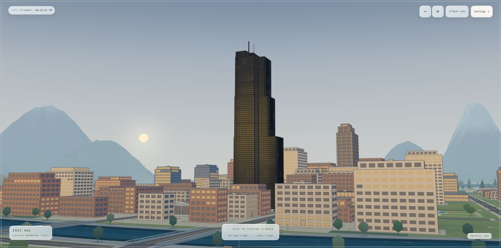

# Final review and polish — October 28, 2026

This checkpoint reviews the local working tree based on `95740094ad9e286d17283cb06a3ee51e8b087c86`. The fixes below are uncommitted and unpublished. The separate [Phase 3 record](../release-phase-3/README.md) describes the live release.

## Changes

- Added the missing audio content types, byte lengths and single-range responses to the phone preview server. Safari-style `bytes=0-1` requests, seeking ranges, unsatisfiable ranges, HEAD and If-Range behavior now have coverage. The public-file allowlist remains in place.
- Fixed `ls /` and normalized parent paths in the bedroom terminal's virtual filesystem.
- Fixed a queued native-dialog close event disabling an activity after it had reopened or restoring focus behind another open activity. The regression test reproduces the failure before the fix.
- Added readable occupied-port errors to both preview commands. Tests verify a failure exit and that the existing server remains reachable.
- Removed the desktop EH—001 badge and palette chips and positioned the clock at the upper left, matching the earlier interface request.
- Updated stale maintenance, roadmap and evidence-index descriptions while preserving historical test results.

## Verification

| Check | Result | Evidence |
| --- | --- | --- |
| `npm run check` | 219 tests and 87 module/reference checks pass; generated content is current | [check.log](check.log) |
| `npm test` | Desktop, mobile, reduced motion, room deep link and unavailable WebGL all pass | [integration.log](integration.log) |
| Real WebGL, 1280 × 720 | 31 views and object responses in 23 rooms pass; peak 82 draw calls; zero idle frames over 250 ms; stable resources and complete disposal | [webgl.json](webgl.json) |
| Responsive camera/settings controls | All eight tower/room layouts pass at 320 × 568, 390 × 650, 650 × 390 and 1280 × 720 | [controls.json](controls.json) |
| Mobile usability, 390 × 844 with simulated safe insets | 49 views pass, including rooms, all seven games, dialogs, content selection, reachable controls and zoom stops | [mobile.json](mobile.json) |
| Automated accessibility | 36 views; zero automated WCAG A/AA violations; ARIA control references resolve | [accessibility.json](accessibility.json) |
| Connected-browser console | No warnings or errors in the app, controls, mobile or accessibility pages | [browser-console.json](browser-console.json) |

The connected browser was Edge on Windows, using the local preview at `http://127.0.0.1:4173/`. A manual terminal check returned `home/` for `ls /`, and closing the desktop restored focus to its opener. The city screenshot confirms the simplified header.

Phone layouts and safe insets were simulated. This pass did not repeat physical iPhone/Safari, native screen-reader or operating-system suspension tests. Their earlier release evidence remains separate. The unavailable-WebGL integration deliberately logs its simulated startup failure before confirming that the complete reading fallback works. Node's VM-module warnings in the integration log are expected test-runner output.
